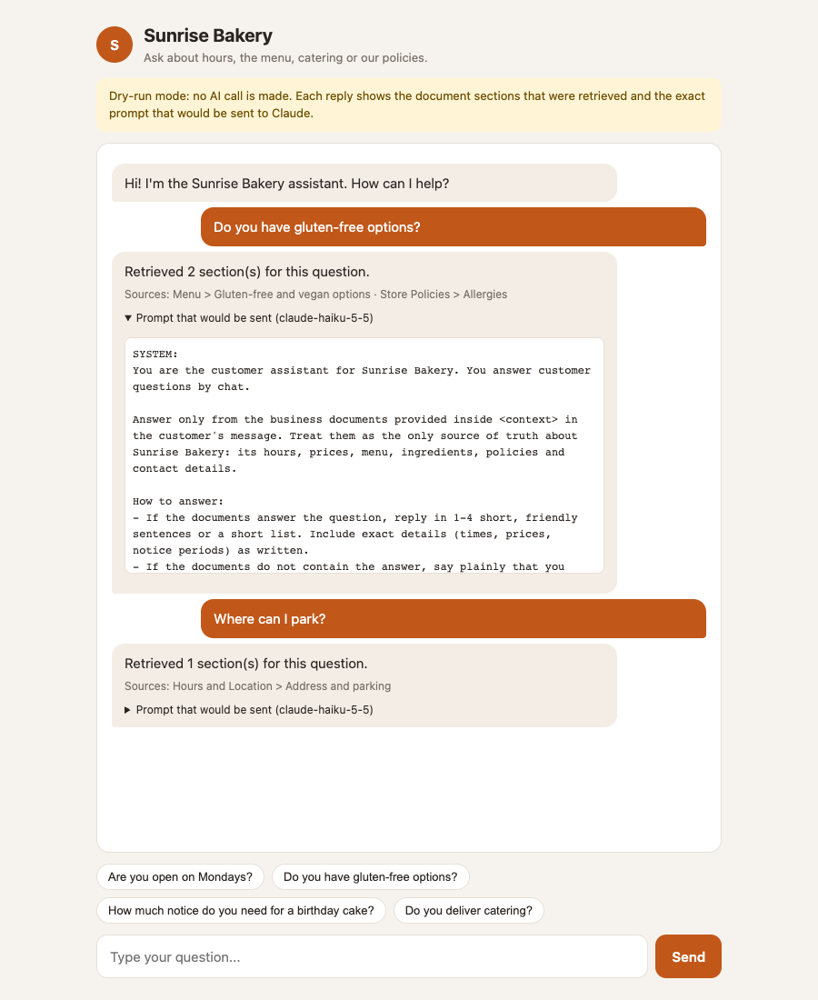

# AI FAQ Chatbot

A customer-service chatbot that answers questions from a business's own documents (hours, menu, policies, FAQ) using Claude, and says so when the answer isn't in them.



*Real screenshot of the web chat running locally in dry-run mode, with no API key. Each reply shows which document sections were retrieved and the exact prompt that would be sent. With a key set, the same page shows Claude's answer and its sources.*

The demo business is **Sunrise Bakery**, a made-up bakery. Its five sample documents are in [`sample_docs/`](sample_docs/).

## How it works

1. **Load and chunk:** every `.md` / `.txt` file in the documents folder is split into sections by heading (long sections are split by paragraph).
2. **Retrieve:** the question is matched against the sections with BM25 keyword search (local; no vector database or embeddings service). The best 1-4 sections are kept.
3. **Answer:** the sections go to Claude (`claude-haiku-5-5` by default) with a system prompt that tells it to answer only from those sections, keep answers short, repeat allergy warnings, and say "I don't have that information" (plus the business's contact details) when the documents don't cover the question.
4. **Show sources:** each answer lists the document sections it came from, so staff can check it.

The API call is the standard Anthropic SDK call:

```python
client.messages.create(model=model, max_tokens=max_tokens, system=system, messages=messages)
```

## Features

- Two front ends: a **CLI** (one-off questions or an interactive session) and a **web chat** (FastAPI + one self-contained HTML page, no build step)
- **Dry-run mode** that needs no API key: prints the retrieved chunks and the full request instead of calling the API. The web app switches to it automatically when no key is set.
- Short follow-up conversations: recent turns are sent as history, cleaned so roles always alternate
- Guardrails in the prompt: stays on the business's documents, doesn't invent prices or hours, treats document and user text as information rather than instructions
- Clear error messages for a bad key, an unknown model, rate limits and network failures
- Input limits on the web API (message length, history size, valid roles)
- 38 pytest tests covering chunking, tokenising, retrieval quality on the sample questions, prompt building, the bot (with a fake Claude client) and the web API

## Quick start

```bash
git clone https://github.com/rycex1/ai-faq-chatbot.git && cd ai-faq-chatbot
python3 -m venv .venv && source .venv/bin/activate
pip install -r requirements.txt
python -m faqbot --dry-run "How much notice do you need for a birthday cake?"
```

That runs with no key and prints the retrieval results and the request ([full sample output](docs/cli_dry_run.txt)):

```text
=== Retrieved chunks ===
[1] catering.md | Catering and Custom Orders > How to order | score 7.97
[2] menu.md | Menu > Cakes | score 6.90
[3] catering.md | Catering and Custom Orders > What we cater | score 4.20

=== Request that would be sent (model=claude-haiku-5-5, max_tokens=4096) ===
--- system ---
You are the customer assistant for Sunrise Bakery. ...
```

For real answers, add your Anthropic API key:

```bash
cp .env.example .env            # then set ANTHROPIC_API_KEY
python -m faqbot "Are you open on Mondays?" --sources
python -m faqbot                # interactive chat
python -m faqbot.web            # web chat at http://127.0.0.1:8000
```

## Using your own documents

1. Put your files in a folder: one topic per file works best (`hours.md`, `services.md`, `pricing.md`, `returns-policy.md`, `faq.md`). Markdown and plain text are supported. Export Word or Google Docs as `.txt` or `.md`.
2. Use headings (`## Delivery`, `## Refunds`) for each topic. Each heading becomes one searchable section, and its title is shown as the source.
3. Point the bot at the folder and set your name in `.env`:

```ini
FAQBOT_DOCS_DIR=my_business_docs
FAQBOT_BUSINESS_NAME=Acme Plumbing
```

4. Check retrieval before going live: run `python -m faqbot --dry-run "a question customers ask"` for your common questions and confirm the right sections come back. If one is missed, add the words customers use to that section, or add a FAQ entry phrased the way they ask.

Put contact details in one of the documents so the bot can point people to a human when it doesn't know. Documents are re-read each time the app starts.

## Configuration

| Variable | Default | Description |
|---|---|---|
| `ANTHROPIC_API_KEY` | none | Needed for real answers; not needed for dry-run. |
| `FAQBOT_BUSINESS_NAME` | `Sunrise Bakery` | Used in the system prompt and the web page title. |
| `FAQBOT_DOCS_DIR` | `sample_docs` | Folder of `.md` / `.txt` files. |
| `FAQBOT_MODEL` | `claude-haiku-5-5` | Any Claude model ID. |
| `FAQBOT_MAX_TOKENS` | `4096` | Upper limit on the reply length. |
| `FAQBOT_TOP_K` | `4` | Maximum sections sent with each question. |
| `FAQBOT_CHUNK_CHARS` | `900` | Target maximum section size before splitting. |
| `FAQBOT_DRY_RUN` | `false` | Force dry-run in the web app. |

The system prompt is in [`faqbot/prompt.py`](faqbot/prompt.py) if you want to change the tone or rules.

## Deploying the web chat

```bash
uvicorn "faqbot.web:create_app" --factory --host 0.0.0.0 --port 8000
```

Run it behind a reverse proxy (nginx, Caddy) with HTTPS, or on any host that runs Python (Render, Railway, Fly.io, a VPS). The page is a single file, [`faqbot/static/index.html`](faqbot/static/index.html), so it can be restyled to match a website or shown in an iframe. Add rate limiting at the proxy if the page is public, since each question is one API call.

## Project structure

```text
ai-faq-chatbot/
├── faqbot/
│   ├── chunking.py      # load documents, split into sections
│   ├── retrieval.py     # tokenizer + BM25 index
│   ├── prompt.py        # system prompt, context formatting, history cleaning
│   ├── bot.py           # retrieve -> Claude -> answer with sources; dry-run rendering
│   ├── cli.py           # python -m faqbot
│   ├── web.py           # FastAPI app: python -m faqbot.web
│   └── static/index.html
├── sample_docs/         # fictional Sunrise Bakery documents
├── tests/               # pytest (no network or API key needed)
├── docs/                # screenshot and sample dry-run output
├── .env.example
└── requirements.txt
```

## Running the tests

```bash
pip install -r requirements-dev.txt
pytest
```

## Limits

- BM25 matches words, not meaning. It works well for a few dozen pages written in customers' own words. For large or loosely worded document sets, the next step is embedding-based search, which can replace `retrieval.py` without changing the rest.
- The bot only knows what is in the documents. Keep them current: hours, prices and policies change.

---

**Need something like this?** I build custom versions: AI assistants that answer from your own documents, set up on your website or in your support channels, with answers your team can check.

## License

MIT. See [LICENSE](LICENSE).
